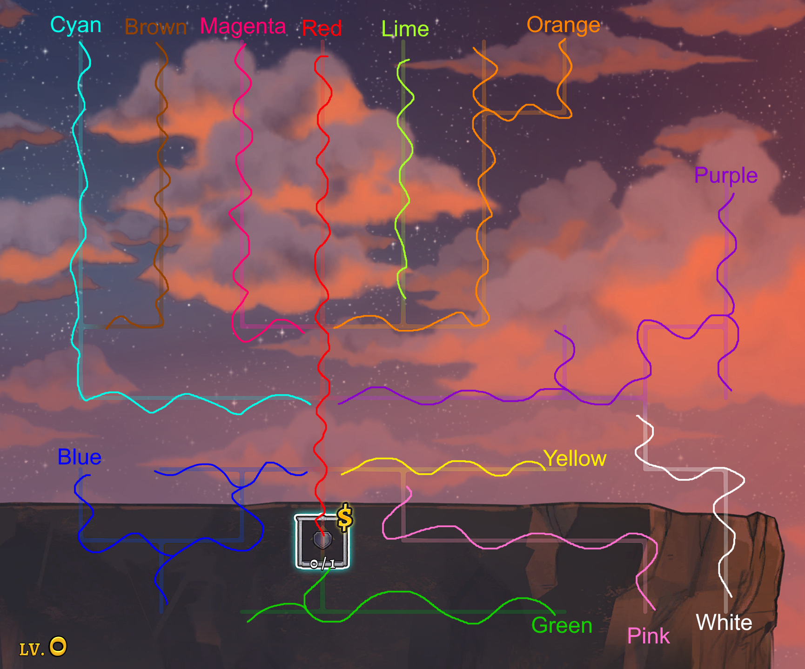

# Rogue Legacy 2 Archipelago Randomizer
This is a mod for Rogue Legacy 2 which integrates the game with the [Archipelago project](https://archipelago.gg)

## Gameplay and Randomization Features / Changes

The run is completed as normal by defeating Cain. All biome bosses must be defeated to unlock the golden doors as normal. All collectables in the run are randomized:

- All manor upgrades (class unlocks, stat increases, etc.), heirlooms, blueprints, runes, and teleporter unlocks are shuffled into randomized locations
- Locations where items can be found:
  - Fairy chests
  - Normal and Silver chests (items drop with the same probability as blueprints would in normal gameplay)
  - Boss and mini-boss kills
  - Journals and memories (configurable)
  - Class mastery ranks (configurable)
  - Manor upgrades (configurable)
  - Pizza girl purchases
  - Heirloom statues (and Johann's conversation in Pishon Dry Lake after defeating Irad)

### Manor Upgrade Location Names

> These names apply to the default **tree** manor layout (decided by the `manor_layout` YAML option). Under the **shop** layout the manor has four numbered positions instead and its locations are named `Manor - Slot 2 Purchase 7`. See [Manor Layout](#manor-layout-manor_layout-manor_shop_depth).

The manor upgrade tree doesn't have intuitive in-game names for its individual slots, so the location associated with each one is named after a given colored path it sits on and its position along that path, for example, `Cyan Path Upgrade 4` or `Red Path Upgrade 7`. The mod draws these colored paths directly onto the manor screen in-game so a location name can be traced to the slot it refers to.

If you have trouble distinguishing the path colors, the chart below labels each one with its name in text.

<details>
<summary>Expand to see the labeled manor path chart</summary>



</details>

### Activating Burdens

Players can choose their preferred burdens the first time they connect to the Archipelago server. These burdens will persist for that entire Archipelago seed. All burdens can be enabled during a randomized run. 

Burdens are not required and they don't affect any other player's worlds. They are provided solely for experienced players who prefer to add more difficulty to their own run. All items and locations remain unnaffected. Killing the prime version of a boss is equivalent to killing the non-prime version. In addition, burdens do not provide any gold bonus like they would in vanilla gameplay.

These burdens are intended to be set once and then locked in for the run. However, if you need to alter them, it can be done by enabling Debug Keys within the Archipelago Settings menu. Pressing '6' on your keyboard will re-open the dialog box and allow you to change the burdens which are applied. Please note that burdens only take affect the next time you select an heir. Changing burdens while in the castle will not take affect until you die.

## Configurable options (i.e. The player YAML)

There are several things that can be customized for each run using the Archipelago YAML file

<details>
<summary>Expand to see the YAML configuration options</summary>

---

### Deathlink (`death_link`)

**Values:** enabled / disabled

Kills your character when another player with deathlink enabled dies. Triggers deaths for other players with deathlink enabled when you die.

---

### Normal/Silver Chest Checks per Biome (`blueprint_checks_per_biome`)

**Range:** 0–16 | **Default:** 11 *(11 checks × 6 biomes = 66 checks, approximately matching the 65 total blueprints in the base game)*

Normal and silver chests have a random chance to roll into an AP item (by default the same probability as the base game: 15% for a normal chest, 99% for a silver chest - see `bronze_chest_ap_chance` and `silver_chest_ap_chance` below). This setting controls how many AP checks you can get from opening chests in each biome. Once all checks have been completed in a biome, all chests will only give gold, like the base game.

---

### Fairy Chest Checks per Biome (`rune_checks_per_biome`)

**Range:** 0–16 | **Default:** 4 *(4 checks × 6 biomes = 24 checks, matching the 24 total runes in the base game)*

When a fairy chest is opened, an AP item will be given every time until the pool is exhausted (see `fairy_chest_ap_chance` below to make this a percentage chance instead). Then chests will just drop red aether as normal.

---

### Chest AP Chances (`bronze_chest_ap_chance`, `silver_chest_ap_chance`, `fairy_chest_ap_chance`)

| Setting | Range | Default |
|---|---|---|
| `bronze_chest_ap_chance` | 1–100 | 15 |
| `silver_chest_ap_chance` | 1–100 | 99 |
| `fairy_chest_ap_chance` | 1–100 | 100 |

The percent chance that opening a chest of the given type triggers an AP location check rather than dropping normal loot. The defaults for bronze and silver chests match the base game's blueprint drop rates, and fairy chests always give a check by default.

Each chest type can be tuned independently. Raising a value means fewer chests need to be opened to clear a biome's pool; lowering it means more. Once a biome's pool of checks is exhausted (see the two settings above), chests fall back to normal loot: gold for bronze/silver, red aether for fairy chests, regardless of these settings.

---

### Manor Layout (`manor_layout`, `manor_shop_depth`)

**`manor_layout` values:** `tree`, `shop` | **Default:** `tree`
**`manor_shop_depth` range:** 1–100 | **Default:** 25

Controls how the manor is structured, and with it how many manor checks the run has.

**`tree`** is the base game's manor: 72 nodes in a fixed branching order, each one is its own check, and a nodes are only purchase-able once the node before it has bought, same as vanilla. Each node is also only purchase-able a single time, unlike vanilla. The number of purchases cannot be raised or lowered in this layout.

**`shop`** replaces the tree with a new layout that allows you to customize how many total purchases are available in the manor. It displays four shop positions (like the Unfair Flips shop). All four are always available. Each one offers only a single item at a time. Once you buy it, it is replaced by a new item until you exhaust every item in that node. Purchases get more expensive the further into each node you buy, and you can purchase one node many times without purchasing the other nodes at all if you prefer.

`manor_shop_depth` sets how many purchases deep each position goes if the manor is in the shop layout. In that case, the manor has **4 x depth** checks (4 slots each one with `depth` purchases). This works out to 100 checks at the default depth of 25 vs the tree layou's fixed 72.

Cost scales with how deep into a position a purchase sits, using the same formula as the tree (see [Manor Upgrade Costs](#manor-upgrade-costs-manor_cost_base-manor_cost_min_subtractive_factor-manor_cost_max_additive_factor)).

The [`reveal_manor_upgrades`](#reveal-manor-upgrades-reveal_manor_upgrades) option only applies to the tree layout since the shop will only show you the immediately available items. [`manor_depth_percent_per_boss`](#manor-depth-percent-per-boss-gate-manor_depth_percent_per_boss) applies regardless of layout.

---

### Manor Upgrade Bundle Size (`manor_upgrade_bundle_size`)

**Range:** 1–35 | **Default:** 5

Many manor upgrades have multiple levels available. In the randomizer, granting only one level at a time would make progression feel too slow for most players. So instead, these multi-level upgrades are granted in bundles; checking one AP location can grant a bundle which gives *n* levels to a manor upgrade (e.g. +5 dexterity instead of +1).

This setting controls how big each bundle is, and therefore how many AP items are created for manor upgrades. For example, if an upgrade has 20 total levels, a bundle size of 5 results in 4 AP items; a bundle size of 10 results in only 2. The total levels for a slot are based on the max level excluding NG+ soul shop purchases. Generally, increasing this number makes the run easier and decreasing it makes it harder.

If the max level for a particular skill is not divisible by the bundle size, the last bundle will be capped to the max level and grant fewer levels than the others.

---


### Journal/Memory Checks (`journal_checks`)

**Values:** `disabled` / `individual` / `grouped` | **Default:** `grouped`

Controls how AP checks are awarded from reading journals and memories.

- **disabled** - no AP checks for journals or memories
- **individual** - one check per unique journal or memory read
- **grouped** - one check after reading all journals in a biome, and one after reading all memories in a biome

There are 41 total memories and journals, and 8 groups (some biomes have no memories and therefore no group check).

---

### Mastery Level Checks (`mastery_checks`, `total_mastery_levels`, `mastery_levels_per_class`)

| Setting | Values / Range | Default |
|---|---|---|
| `mastery_checks` | `disabled` / `total` / `per_class` | `total` |
| `total_mastery_levels` | 1–750 | 50 |
| `mastery_levels_per_class` | 1–50 | 10 |

Controls how class mastery ranks award AP checks. XP comes from killing enemies and the game converts this XP into mastery rank levels when an heir dies. This does mean you will not receive mastery checks mid-run, they only come when you return to the manor.

- **disabled** - no mastery checks
- **total** - each overall mastery level is one check. The overall level is the sum of every class's rank. `total_mastery_levels` sets how many levels are checks, and therefore how many locations this adds.
- **per_class** - each of the 15 classes' rank has its own checks, giving `15 × mastery_levels_per_class` locations. Considerably grindier than **total** and includes inherent randomization since you can't intentionally choose a class you want.

#### How the Mastery Level Checks interact with the Sage Totem

In the base game, no mastery XP accrues at all until the Sage Totem (the **Mastery Rank Unlock** manor upgrade) is bought. This seems silly for a randomizer, so the mod allows you to begin gaining XP immediately so mastery level locations can be checked from the start of a run. However, the stat bonuses that come from mastery level ranks are still gated behind the Sage Totem unlock, so it is still useful.

---

### Mastery XP Multiplier (`mastery_xp_multiplier`)

**Range:** 10–10000 | **Default:** 300

Scales every mastery XP award, as a percentage. 100 is the base-game rate, 200 doubles it, 50 halves it. The default is deliberately well above the base-game rate, because vanilla's XP curve is too slow for a reasonable Archipelago run.

This is useful if you want many mastery rank checks without a long grind: raise `total_mastery_levels` (or `mastery_levels_per_class`) for more checks, then raise this so they still arrive at a reasonable pace.

This setting still applies with `mastery_checks` set to `disabled`.

---

### Trap Count (`trap_count`)

**Range:** 0–25 | **Default:** 3

Traps are a feature in Archipelago where checking a location may give the player a negative reward. In Rogue Legacy 2, traps activate a random biome environmental burden for the remainder of the current heir's life. This effect will occur in all valid rooms, not just the intended biome.

There are 5 available traps:
- Cannonball Rain *(Burden of Mundi's Flagship)*
- Dragon Lancers *(Burden of Irad's Torment)*
- Automaton Swarm *(Burden of Pishon's Uprising)*
- Giant Snowflakes *(Burden of Kerguelen's Frost)*
- Void Waves *(Burden of the High Scholar's Metamorphosis)*

Traps are distributed as evenly as possible across the five types. Set to 0 to disable traps entirely.

---

### Trap Appearance (`trap_appearance`)

**Values:** `hidden` / `visible` | **Default:** `hidden`

Controls whether traps can be identified before you pay for them. Anywhere the game shows what an unclaimed location holds (the manor upgrade tree, the teleporter NPC, heirloom pedestals), a trap would otherwise announce itself and be trivially avoidable.

- **hidden** - traps are disguised as a real item taken from elsewhere in the multiworld, and are only revealed once purchased
- **visible** - traps show their true name and icon before purchase

---

### Manor Upgrade Costs (`manor_cost_base`, `manor_cost_min_subtractive_factor`, `manor_cost_max_additive_factor`)

| Setting | Range | Default |
|---|---|---|
| `manor_cost_base` | 1–9999 | 100 |
| `manor_cost_min_subtractive_factor` | 0–100 | 20 |
| `manor_cost_max_additive_factor` | 0–500 | 50 |

The typical manor upgrade costs don't scale well in an Archipelago run, so a custom pricing formula is used. It incorporates a "depth" value which is determined by how many prior manor purchases were required to unlock a given slot. The first available slot is depth 1; slots unlocked after the first purchase are depth 2; and so on, up to the maximum depth (25 by default in the manor's shop layout, 11 for the manor's tree layout).

The formula is:

```
cost = base × depth × random_factor
```

`random_factor` is a random decimal chosen uniformly between `(1 - subtractive_factor/100)` and `(1 + additive_factor/100)`. With the defaults, this means each upgrade costs `base × depth`, then randomly adjusted to be up to 20% cheaper or 50% more expensive.

---

### Progression Gating

> **Warning:** Tightening these options can cause generation errors if the resulting logical requirements become too difficult to satisfy.

#### Manor Depth Percent Per Boss Gate (`manor_depth_percent_per_boss`)

**Range:** 0–100 | **Default:** 25

Each manor upgrade has a "depth" value: how many upgrades had to be purchased before it becomes available for purchase. This setting controls what percentage of the total depth of of the manor is added to the "in-logic" pool per boss killed. The shallowest *x*% is always in logic; each subsequent boss opens the next *x*%.

With the default value of 25 (meaning 25%), a quarter of the manor opens up per boss, so the whole thing is in logic after 3 bosses. On the vanilla 11-deep tree that works out to depths 1–3 from the start, 4–6 after 1 boss, 7–9 after 2, and 10–11 after 3+.

Set it to 100 to put the entire manor in logic from the start, or 0 to disable this gating entirely.

---

#### Chest Pre-Boss Percent (`chest_pre_boss_percent`)

**Range:** 50–100 | **Default:** 75

The percentage of each biome's blueprint chest and fairy chest locations considered in logic *before* the biome's boss is killed. The remaining checks only become in-logic after the boss is defeated.

This reduces the chance of a situation where every chest in a biome must be cleared just to obtain the items needed to beat its boss.

---

#### Stat Upgrades Per Boss (`stat_upgrades_per_boss`)

**Range:** 0–10 | **Default:** 5

The number of received stat upgrade items required such that the next boss is considered "in-logic", scaling additively per boss. With the default of 5: Estuary Lamech requires 5 upgrades, Byarrrith and Halpharr require 10, Estuary Naamah requires 15, Estuary Enoch requires 20, Estuary Irad requires 25, and Estuary Tubal requires 30. The Gonghead and Murmur minibosses share Naamah's threshold; the Pishon Dry Lake minibosses share Irad's.

Set to 0 to disable stat-upgrade gating for bosses.

---

#### Stat Upgrades Per Biome Tier (`stat_upgrades_per_biome_tier`)

**Range:** 0–10 | **Default:** 5

The base number of received stat upgrade items logically required before each later biome's chest and journal/memory locations are considered in logic. The requirement scales per biome starting at biome 3: Kerguelen Plateau requires *x*, Stygian Study requires *2x*, Sun Tower requires *3x*, and Pishon Dry Lake requires *4x*. Citadel Agartha and Axis Mundi are never gated by this setting.

Set to 0 to disable stat-upgrade gating for biomes.

---

#### Mastery Progression Percent (`mastery_progression_percent`)

**Range:** 0–100 | **Default:** 50

How much of the mastery chain is allowed to hold an item worth having. Only relevant when `mastery_checks` is enabled. Anything past this point in the mastery level rank locations is guaranteed not to have something useful or required. Instead they will just have filler.

With the default of 50 and `total_mastery_levels: 25`, ranks 1–12 can hold real items and ranks 13–25 hold gold (or a trap). In **per_class** mode the split is applied within each class, so every class keeps the same shallow stretch of live ranks.

Set it to 100 to put the whole chain in play, or 0 to make all of it filler. 

---

#### Early NPC Unlocks (`early_npc_unlocks`)

**Values:** true / false | **Default:** true

When enabled, soft logic rules push the three NPC unlock items (Living Safe, Blacksmith, Enchantress) toward earlier locations in the run, reducing the chance they are gated deep into a long seed.

---

### Randomize Starting Class (`randomize_starting_class`)

**Values:** enabled / disabled | **Default:** enabled

When enabled, the default unlocked class is randomized instead of always being a knight. The chosen class is pre-unlocked at run start and removed from the item pool. If the starting class is not Knight, the Knight class becomes a randomizable item in the multiworld and must be found before Knight heirs can appear.

---

### Fabled Weapons (`fabled_weapons`)

**Values:** `randomized`, `soul_shop`, `unlocked` | **Default:** `randomized`

How fabled weapons are obtained.

**`randomized`** shuffles them into the multiworld. Class items become **progressive**: the first copy of `Progressive Boxer Class` unlocks the Boxer, and the second unlocks the Boxer's fabled weapon.

**`soul_shop`** leaves them as vanilla Soul Shop purchases. Class items are plain one-stage unlocks named `Upgrade: Boxer Class`, and the fabled weapons stay listed in the shop and cost Souls. Although they are ungated, so they are available from the start.

**`unlocked`** gives every class its fabled weapon for free as soon as that class is unlocked. Similar to `soul_shop`, class items are plain one-stage unlocks.

---

### Reveal Manor Upgrades (`reveal_manor_upgrades`)

**Values:** true / false | **Default:** false

When enabled, every manor upgrade node is shown from the start instead of only the ones adjacent to a purchase. This makes it easier to see the whole tree and plan a route through it.

Purchase rules are unchanged: a node still cannot be bought until the node before it has been purchased. Revealed-but-locked nodes show a padlock.

Only applies to the [tree layout](#manor-layout-manor_layout-manor_shop_depth). The shop layout always shows exactly the next purchase at each of its four positions, so there is nothing to reveal.

</details>


## Installation

Rogue Legacy 2 must already be installed. All files needed can be downloaded from the [GitHub releases page](https://github.com/zaphim12/RL2Archipelago/releases). Look at the most recent release and scroll down to Assets.

> **Note:** Mac and Linux compatibility should work fine, and users have successfully completed runs on both. The most thoroughly tested version is Windows, though.

### Installing the Mod

1. Download and install [BepInEx](https://docs.bepinex.dev/articles/user_guide/installation/index.html). BepInEx is the mod injector that allows the mod to modify gameplay without altering game files.
   - Any latest stable release will work. The BepInEx installation page links to their GitHub releases. Scroll to Assets and download the version for your OS.
   - Extract the BepInEx files into the game's root directory. On Windows this is typically: `C:\Program Files (x86)\Steam\steamapps\common\Rogue Legacy 2\`
   - Run the game once so BepInEx can generate its required files.

2. Download and extract the RL2Archipelago mod files into BepInEx's plugins folder.
   - If you are only playing (not generating the Archipelago world), you only need `RL2Archipelago.zip`.
   - If the `plugins` folder doesn't exist within the BepInEx directory, create it.
   - Your final path after extracting should be (on Windows): `C:\Program Files (x86)\Steam\steamapps\common\Rogue Legacy 2\BepInEx\plugins\RL2Archipelago`

### Generating the Archipelago

1. Make sure the person generating the Archipelago has a player YAML and the `.apworld` file.
   - There are two easy ways to get a player YAML:
     - Download `RL2_template.yaml` from the GitHub releases page, then edit it to customize your run. You can rename it to anything you like.
     - Use the Archipelago launcher: first install the APWorld via "Install APWorld", then use the "Options Creator" to generate a player YAML.
   - Whoever generates the Archipelago will need to add the `.apworld` to their Archipelago launcher installation.

## Troubleshooting

### I installed the mod, but I don't see any Archipelago settings or a way to connect

If you've installed the game properly then there should be a new option on the main menu titled "Connect to Archipelago" which opens a dialog box for you to enter the Archipelago server details. If you don't see this that means the mod was not installed correctly. This typically happens for one of a few reasons:
1. **The wrong version of BepInEx was installed.** Double check that you downloaded the correct version of BepInEx for your operating system (Windows/Linux/Mac) and the correct variant if on Windows (x86/x64). Using the wrong version will fail to load the mod.
2. **The files were not extracted from the zipped format.** The mod is provided in a .zip format. To install the mod, you have to unzip it and place the individual files into the plugins folder.
3. **The files were not placed into the correct directory.** Ensure that your files are in the `...\BepInEx\plugins` folder. You will likely have to create this folder yourself if it's not there.
4. **All of the above were done and it's still not working,** Just try the whole process over from step 1. And make extra sure that BepInEx loads on its own first before moving on to installing the mod. Most often the issue is with the BepInEx install and not the Archipelago mod.

### "Progress is NOT being saved"

If a red banner reading **`[!] Progress is NOT being saved`** appears in the top-right corner, the game has stopped writing save files. It will keep letting you play, but nothing you do will be saved.

**Stop playing as soon as you see it.** Finishing the run won't help, because your progression will not be saved.

**What you keep:** your Archipelago progress is safe. Checks you've sent and items you've received are tracked by the mod separately from the game's save, and your items are restored automatically the next time you connect.

**What you lose:** anything that lives only in the game's save (gold, your heir lineage, map exploration, equipment upgrades) since the last successful save.

**What to do:**

1. **Quit to desktop.** If you have backups available (one should be created at the start of each heir's run), restarting the game may allow you to recover most or all of your game's progress.
2. **Re-open the game and connect to the Archipelago world.** The mod re-checks for your save whenever it connects.
   - **If it connects normally,** the warning can be ignored. Your items are restored automatically, so just carry on.
   - **If it refuses to connect,** the vanilla game's own **Save File Error** prompt will appear. The dialog will explain how to go about loading a backup or it will inform you that none are available. If you have a backup, choose **Load Backup** and pick the most recent entry, then connect again. Rogue Legacy 2 writes a backup every time you enter the castle, so you will lose at most the run you were on.
3. **Don't delete anything,** Unless you know what you are doing, manually manipulating save files may lose a run that is potentially recoverable. Feel free to send a message in the discord to ask for help if you need it.

### My items disappeared

Connect to the slot again. On every connect the mod compares what the multiworld says you have been sent against what is actually in your save, and puts back anything missing before you press Start. This should appear as `[APSync] Restored ...` lines in the BepInEx log.

### Reporting a problem

Either send a message in the Discord or create an issue on Github.
Please include:

- `...\Rogue Legacy 2\BepInEx\LogOutput.log` (This is the Rogue Legacy 2 install location, you can Google how to find this for your operating system)
- A directory listing of your seed's save folder:
  `...\Cellar Door Games\Rogue Legacy 2\AP_Saves\<RoomId>_<SlotName>\` (This is the location where Rogue Legacy 2 stores your saves, this is different from the above directory. You can Google where to find this for your operating system, as well)

## Disclaimers

- This mod requires a legitimate copy of Rogue Legacy 2.
- This is an unofficial mod and is not affiliated with Cellar Door Games.

## Contact Info

Feel free to open an issue here on GitHub for any questions or bugs. You can also reach me on Discord at @zaphim12. I'm in the [Archipelago Discord server](https://discord.gg/8Z65BR2) and can be messaged directly or via the `#rogue-legacy-2` channel.
